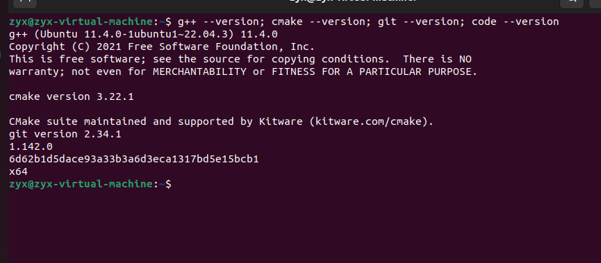
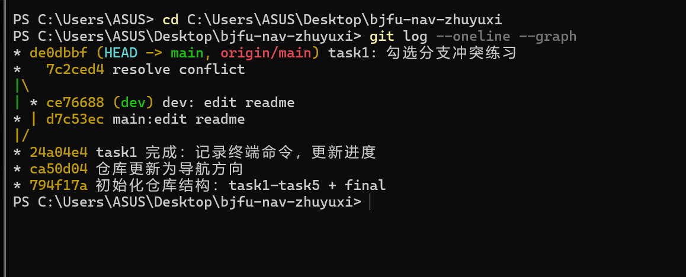

# Hello Ubuntu & Git - 任务记录

## 已完成
- [x] 安装 Ubuntu 22.04（虚拟机）
- [x] 安装 g++/cmake/git/VS Code
- [x] 终端命令练习（见 commands.md）
- [x] GitHub SSH 配置与仓库推送
- [x] 分支冲突练习

## 编译运行方法
（本任务为环境搭建，无代码编译；工具验证命令：g++ --version / cmake --version / git --version / code --version）

## 效果截图

### 工具链版本验证（Ubuntu 终端）

### 分支合并记录（git log --oneline --graph）

