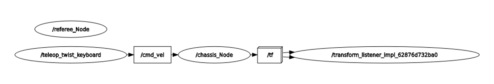
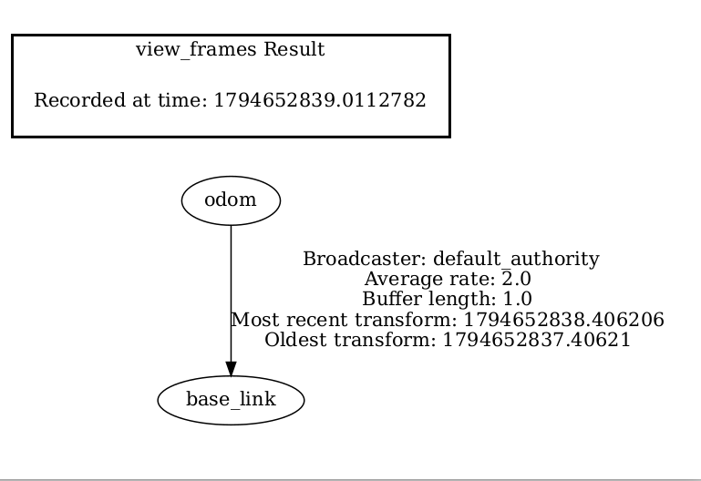
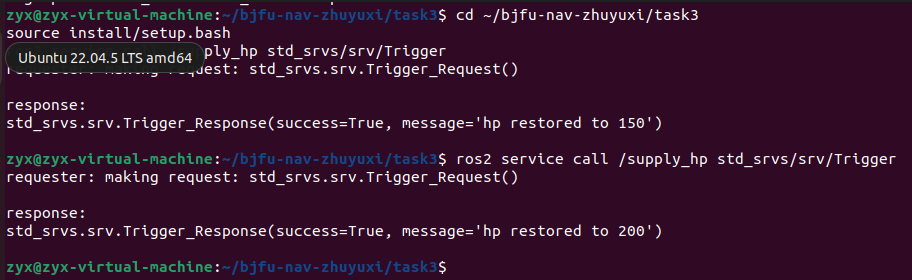

任务三：Hello OOP & ROS 2
基于 Ubuntu 22.04 + ROS 2 Humble，用面向对象 C++ 实现两个 ROS 2 节点，完成话题通信、服务调用与 TF2 坐标变换。
环境
操作系统：Ubuntu 22.04.5 LTS（VMware 虚拟机）
ROS 2：Humble
构建工具：colcon，功能包类型 ament_cmake
功能概述
节点
职责
chassis_Node（底盘节点）
订阅速度指令，积分里程计位姿，发布 /odom 并广播 odom → base_link 的 TF2 变换
referee_Node（裁判模拟节点）
周期发布比赛阶段、血量、弹量话题；提供回血服务 /supply_hp

接口说明
底盘节点 chassis_Node
类型
名称
消息类型
说明
订阅
/cmd_vel
geometry_msgs/msg/Twist
底盘速度指令（线速度、角速度）
发布
/odom
nav_msgs/msg/Odometry
积分得到的里程计位姿与速度
TF 广播
odom → base_link
tf2_msgs/msg/TFMessage
里程计坐标系到车体坐标系的变换

裁判节点 referee_Node
类型
名称
消息类型
说明
发布
/game_stage
std_msgs/msg/Int32
比赛阶段，初始 1
发布
/hp
std_msgs/msg/Int32
血量，初始 100，上限 200
发布
/ammo
std_msgs/msg/Int32
弹量，初始 200
服务
/supply_hp
std_srvs/srv/Trigger
回血服务，调用一次 +50，封顶 200

状态话题由 500 ms 定时器周期发布。
编译与运行
1. 编译
cd ~/bjfu-nav-zhuyuxi/task3
source /opt/ros/humble/setup.bash
colcon build --packages-select rm_nav_demo
source install/setup.bash

2. 一键启动底盘节点、裁判节点与 RViz2
ros2 launch rm_nav_demo demo.launch.py

3. 键盘控制（单独终端）
cd ~/bjfu-nav-zhuyuxi/task3
source install/setup.bash
ros2 run teleop_twist_keyboard teleop_twist_keyboard

按键：i 前进、, 后退、j/l 转向、k 停止。
4. 调用回血服务（单独终端）
cd ~/bjfu-nav-zhuyuxi/task3
source install/setup.bash
ros2 service call /supply_hp std_srvs/srv/Trigger

5. RViz2 配置
Fixed Frame 选择 odom
Add → TF，显示 base_link 坐标轴
验收记录
节点关系图（rqt_graph）

链路：teleop_twist_keyboard → /cmd_vel → chassis_Node → /tf → transform_listener；referee_Node 发布 /game_stage、/hp、/ammo。
TF 树（view_frames）

odom 坐标系通过 TF2 变换连接到 base_link。
服务回血

两次调用 /supply_hp，返回 success=True，血量从 150 恢复到 200（达到上限）。
运行录屏
键盘驱动 RViz2 中 base_link 坐标系平滑移动的演示录屏见本任务 Issue 附件。
代码结构
task3/src/rm_nav_demo/
├── CMakeLists.txt
├── package.xml
├── launch/
│   └── demo.launch.py
└── src/
    ├── chassis_node.cpp      # 底盘节点
    └── referee_node.cpp      # 裁判模拟节点
