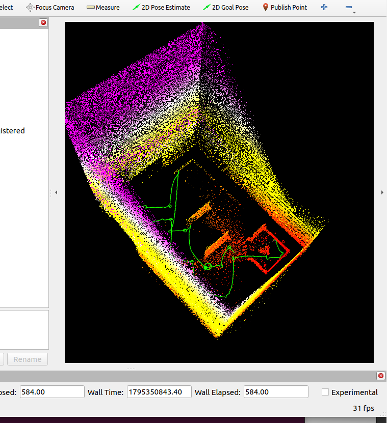
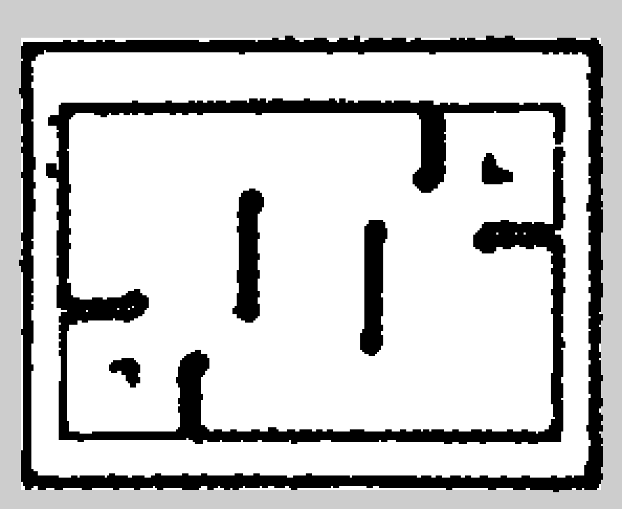
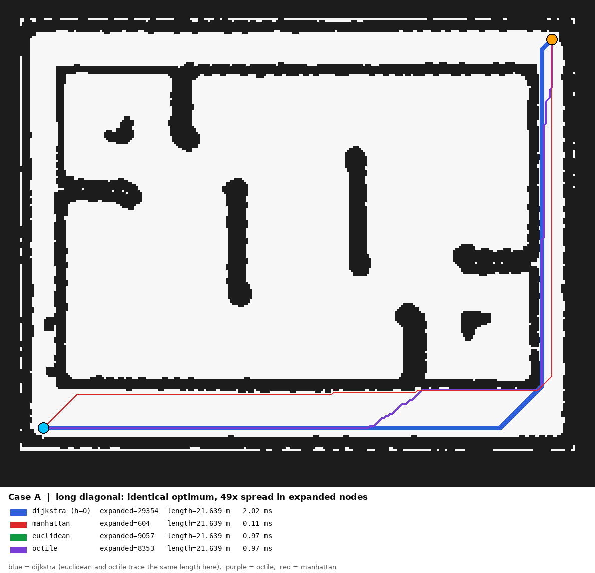
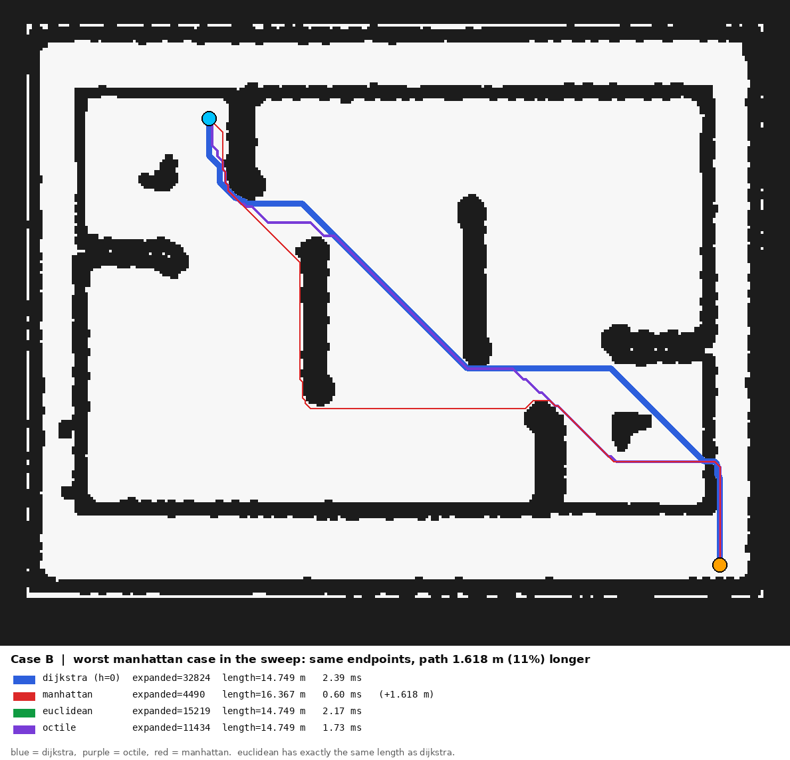

# 任务四：Hello SLAM & Planning（第 5–6 周）

基于 Ubuntu 22.04 + ROS 2 Humble，在 Gazebo 中部署 RMUL 赛场仿真，用 Point-LIO 完成建图并保存点云，把点云转成 Nav2 可用的栅格地图，配置 AMCL 做重定位验证（第 5 周）；再在这张真实栅格地图上手写 A* 规划器并对比启发函数（第 6 周）。

## 环境

- 操作系统：Ubuntu 22.04.5 LTS（VMware 虚拟机，4 核 / 8 GB）
- ROS 2：Humble
- 仿真：Gazebo Classic 11 + `PB_RMSimulation`（`world:=RMUL`）
- 建图算法：Point-LIO
- 定位：AMCL（`nav2_amcl`）

## 流程

| 步骤 | 做什么 | 产物 |
|---|---|---|
| 1 | 启动赛场仿真 + Point-LIO，RViz 查看点云与 IMU | — |
| 2 | 键盘绕场一周建图，`Ctrl+C` 保存 | `scans.pcd`（38 MB） |
| 3 | 点云投影成二维占据栅格 | `rmul_map.pgm` + `rmul_map.yaml` |
| 4 | 地图装入 `rm_nav_bringup`，`mode:=nav localization:=amcl` 重定位 | 位姿收敛 |
| 5 | 在这张栅格上实现 8 邻域 A*，对比四种启发式 | `src/astar_planner` + 对比表 |

## 编译与运行

### 1. 编译仿真工作空间

```bash
cd ~/ws_pb_rm
colcon build --symlink-install --parallel-workers 2
source install/setup.bash
```

### 2. 启动建图

```bash
ros2 launch rm_nav_bringup bringup_sim.launch.py \
  world:=RMUL mode:=mapping lio:=pointlio lio_rviz:=True nav_rviz:=False
```

实测 `/livox/lidar/pointcloud` 约 8.8 Hz、`/imu/data` 约 80~85 Hz、`/Odometry` 约 8.9 Hz。

> `mid360.xacro` 本身不含 IMU 传感器，`/livox/imu` 恒无数据；Point-LIO 订阅的是仿真侧 `complementary_filter` 推出的 `/imu/data`。

### 3. 键盘驱动绕场

```bash
ros2 run teleop_twist_keyboard teleop_twist_keyboard
```

### 4. 保存点云

建图结束后**只按一次 Ctrl+C**，等 20 秒让 Point-LIO 写盘，然后确认文件：

```bash
ls -lh ~/ws_pb_rm/src/rm_localization/point_lio/PCD/scans.pcd
```

### 5. 点云转栅格地图

```bash
cd ~/bjfu-nav-zhuyuxi/task4
python3 tools/pcd2pgm.py \
  ~/ws_pb_rm/src/rm_localization/point_lio/PCD/scans.pcd \
  map/rmul_map.pgm map/rmul_map.yaml \
  --resolution 0.05
```

### 6. 装载地图并启动导航

```bash
cd ~/ws_pb_rm/src/rm_nav_bringup
cp ~/bjfu-nav-zhuyuxi/task4/map/rmul_map.pgm map/RMUL.pgm
cp ~/bjfu-nav-zhuyuxi/task4/map/rmul_map.yaml map/RMUL.yaml
cd ~/ws_pb_rm && colcon build --symlink-install --packages-select rm_nav_bringup
source install/setup.bash
ros2 launch rm_nav_bringup bringup_sim.launch.py \
  world:=RMUL mode:=nav localization:=amcl lio:=pointlio lio_rviz:=False nav_rviz:=True
```

### 7. RViz2 给初始位姿

工具栏 **2D Pose Estimate** 在场地内点选一个与真实位置有偏差的位姿。AMCL 的 `update_min_d` 为 0.10 m、`update_min_a` 为 0.2 rad，必须移动超过这个量才会触发更新。

## 建图结果

- 点云：`scans.pcd`，1215842 点，38 MB
- 栅格：297 × 243 格，分辨率 0.05 m/格，覆盖 14.9 m × 12.2 m
- 占用 / 空闲 / 未知：13193 / 46767 / 12211
- 地图原点（左下角）：`[-4.492, -5.166, 0.0]`





## 转换脚本说明

`tools/pcd2pgm.py` 把 PCD 投影成 map_server 可直接读取的 `.pgm` + `.yaml`。

| 参数 | 含义 | 默认 |
|---|---|---|
| `--resolution` | 栅格分辨率（米/格） | 0.05 |
| `--z-offset` | 障碍物相对地面的最低高度（米） | 0.15 |
| `--z-max` | 障碍物相对地面的最高高度（米） | 2.0 |
| `--min-cluster` | 连通块最小格数，小于此值当噪点删除 | 4 |
| `--inflate` | 障碍物膨胀格数 | 1 |

处理流程：

1. 解析 PCD 头部，支持 `ascii` 与 `binary` 两种存储，按 `FIELDS / SIZE / TYPE / COUNT` 还原坐标
2. 用 z 方向直方图峰值估计地面高度，避免手写 `z_min`
3. 取 `[地面+0.15, 地面+2.0]` 高度区间的点作为障碍物，投影到栅格
4. 连通域过滤：孤立的 1~3 格噪点删除，墙体和障碍物保留
5. 膨胀 1 格，封住墙体上的小缺口
6. 障碍物外接矩形内部、未被占据的格子填为可通行——Nav2 在 `track_unknown_space: true` 时不会规划进未知区，不填会走不出几步

## 重定位验证

### 参数

`localization:=amcl`，`rm_nav_bringup/config/simulation/nav2_params_sim.yaml`：

| 参数 | 值 | 说明 |
|---|---|---|
| `laser_model_type` | `likelihood_field` | 似然场模型 |
| `max_beams` | **300** | 每帧参与打分的激光束数，见"关键发现一" |
| `sigma_hit` | 0.12 | 似然场高斯宽度（m） |
| `z_hit` / `z_rand` | 0.5 / 0.1 | 命中 / 随机项权重 |
| `alpha1~4` | 0.1 | 运动模型噪声 |
| `update_min_d` | **0.10** | 位移超过 0.10 m 才更新 |
| `update_min_a` | 0.2 | 转向超过 0.2 rad 才更新 |
| `max_particles` / `min_particles` | 2000 / 500 | 粒子数 |
| `recovery_alpha_slow` / `fast` | 0 / 0 | 全局重定位关闭，只能局部收敛 |

### 测试方法

真值取 Point-LIO 输出的 `odom → base_link_fake` 变换。用 `/initialpose` 注入初始位姿：

- **偏差**：在真值上叠加 x/y 偏移与 yaw 偏移，合成约 0.48~0.50 m / 14~15.5°
- **协方差**：x/y = 0.25 m²、yaw = 0.068 rad²

两条关键约束：

1. **协方差不能全 0**。全 0 时 2000 个粒子叠在同一个位姿上，权重完全平坦，滤波器退化成纯里程计外推，什么都收敛不了。
2. **偏差必须相对真值注入**。直接给一个固定绝对坐标，车一动偏差就会自己漂大，测出来的是假数据。

两种测试路线：

- **短路线（4 段）**：前进 0.6 m ×2、横移 0.55 m ×1
- **长路线（7 段）**：左横 0.55 → 右横 0.55 → 前进 0.6 → 左横 → 右横 → 前进 0.6 ×2

每段结束读一次 `/amcl_pose`，与真值比较位置误差、yaw 误差与粒子云标准差。

### 三次验收结果

| 组 | 起点偏差 | 路线 | 末态误差 | 末态 yaw | 末态 σ | 判定 |
|---|---|---|---|---|---|---|
| 1 | 0.499 m / 15.5° | 短（4 段） | **0.142 m** | **1.6°** | 0.362 m | 合格 |
| 2 | 0.438 m / 14.7° | 短（4 段） | 0.304 m | 10.2° | 0.450 m | 未达标 |
| 3 | 0.482 m / 13.9° | 长（7 段） | **0.200 m** | **1.4°** | 0.234 m | 合格 |

**第 1 组（短路线，x 正向偏差）**

| 采样 | 误差 (m) | yaw (°) | σ (m) | σ_yaw (°) |
|---|---|---|---|---|
| T0 | 0.499 | 15.5 | 0.511 | 14.4 |
| T1 | 0.527 | 13.3 | 0.486 | 14.1 |
| T2 | 0.287 | 5.2 | 0.454 | 10.8 |
| T3 | 0.142 | 1.6 | 0.362 | 8.0 |

**第 2 组（短路线，x 负向偏差）**

| 采样 | 误差 (m) | yaw (°) | σ (m) | σ_yaw (°) |
|---|---|---|---|---|
| T0 | 0.438 | 14.7 | 0.486 | 14.1 |
| T1 | 0.438 | 12.2 | 0.472 | 12.7 |
| T2 | 0.441 | 12.0 | 0.472 | 12.7 |
| T3 | 0.304 | 10.2 | 0.450 | 11.3 |

**第 3 组（长路线，x 负向偏差，与第 2 组同一偏差）**

| 采样 | 误差 (m) | yaw (°) | σ (m) | σ_yaw (°) |
|---|---|---|---|---|
| T0 | 0.482 | 13.9 | 0.495 | 13.8 |
| T1 | 0.389 | 8.5 | 0.393 | 11.8 |
| T2 | 0.352 | 5.8 | 0.318 | 10.5 |
| T3 | 0.358 | 5.3 | 0.318 | 10.5 |
| T4 | 0.212 | 3.9 | 0.247 | 7.9 |
| T5 | 0.196 | 2.2 | 0.234 | 6.5 |
| T6 | 0.203 | 1.3 | 0.234 | 6.5 |
| T7 | 0.200 | 1.4 | 0.234 | 6.5 |

第 3 组的误差与 yaw 是单调收缩的，不是摆动后偶然命中：

```text
误差 0.482 → 0.389 → 0.352 → 0.358 → 0.212 → 0.196 → 0.203 → 0.200
yaw  13.9  → 8.5   → 5.8   → 5.3   → 3.9   → 2.2   → 1.3   → 1.4
σ    0.495 → 0.393 → 0.318 → 0.318 → 0.247 → 0.234 → 0.234 → 0.234
```

### 结论

给定约 0.5 m / 14~15.5° 的初始偏差，AMCL 能够收敛到判据以内（第 1、3 组分别为 0.142 m / 1.6° 与 0.200 m / 1.4°），且粒子云标准差同步收缩（第 1 组 0.511 → 0.362 m，第 3 组 0.495 → 0.234 m）。

收敛能力由两个必要条件决定，各有一组对照实验支撑。

### 关键发现一：`max_beams` 决定滤波器"看不看得见"

`/scan` 有 1462 条光束，但只有 450 条是有效回波（30.8%）——`pointcloud_to_laserscan` 只保留 0.2 m 高的一个高度窗口，Mid-360 又是非重复扫描，单帧落到薄片里的点本来就不多。

AMCL 的 `max_beams` 不是"取前 90 条有效回波"，而是在 1462 个角度索引上**等间隔抽 90 个**。于是每帧真正参与打分的只有：

```text
90 × (450 / 1462) ≈ 27 条
```

27 条约束不足以拉开不同粒子的权重差。实测对照：

| `max_beams` | 每帧有效约束 | σ 变化 |
|---|---|---|
| 90 | ≈ 27 条 | 0.483 → 0.477，全程不动，误差只从 0.441 收到 0.365 |
| 300 | ≈ 90 条 | 0.495 → 0.234，单调下降，误差收到 0.200 |

提到 300（约 90 条有效约束）后权重才有足够区分度，粒子云开始收缩。继续加收益递减且拖实时率，300 是够用且不亏的值。

### 关键发现二：测试路线必须覆盖多个运动方向

第 2、3 组用**完全相同的偏差**（`-0.35, 0.35, 15°`），唯一变量是路线长度：

| 路线 | 末态误差 | 末态 yaw | σ |
|---|---|---|---|
| 短（前进 ×2 + 横移 ×1） | 0.304 m | 10.2° | 0.450 m |
| 长（左右横移来回 ×4 + 前进 ×3） | 0.200 m | 1.4° | 0.234 m |

单向直线运动只能约束沿运动方向的分量，横向偏移和朝向偏差在扫描里几乎没有反映；只有左右来回横移，才能把 y 与 yaw 也变成可观测的。**这是几何条件，任何参数都替代不了。**

> 现场操作上还有一条硬约束：底盘插件 `fake_vel_transform` 会把任何非零角速度替换成固定 5.0 rad/s，`teleop_twist_keyboard` 按 `j`/`l` 只会原地疯转，无法精确转 15°。验证路线靠直发 `/cmd_vel_chassis` 的 `linear.y` 做横移、`linear.x` 做前进。

### 判据

- 位置误差 ≤ 0.2 m，yaw 误差 ≤ 5°
- 粒子云标准差同步下降，RViz 中粒子云收拢、扫描贴合墙体

第 3 组末态 0.200 m 属压线通过；σ 0.234 m 仍不算窄，若需要更紧的云可继续增加路线长度或减小 `update_min_d`。

### 已排除项（调试记录）

以下因素在设计实验时逐一排除，列出以免重复排查：

| 假设 | 排除依据 |
|---|---|
| 扫描信息量不足 | 36/36 个 10° 扇区均有回波，每帧约 450 条，距离覆盖 1.04~8.80 m |
| 更新次数太少 | 实测 `/amcl_pose` 2.8 Hz，9.8 s 内约 27 次更新 |
| `update_min_d` 阈值太高 | 降到 0.10 后单独改仍不收敛，说明瓶颈不在此 |
| TF 发布频率拖累 | 更新频率 2.8 Hz 正常，与 TF 约 1 Hz 无关 |
| 时间基不一致 | `/scan` 与 TF 时间戳已统一为仿真时间 |
| 初始协方差过大或全 0 | 已修正为 x/y = 0.25 m²、yaw = 0.068 rad² |
| 机器人被环形结构围住、朝向对称 | 仅 11/36 扇区中位距离 < 2 m，不构成封闭环 |
| 扫描把地板混入 | 高度窗口改为 -0.05~0.15 m，最小回波距离 1.04 m，不含车体 |

> 诚实的边界：本次验证只覆盖约 0.5 m / 15° 量级的偏差。`recovery_alpha_slow/fast = 0` 时 AMCL 没有全局重定位能力，偏差再大（2 m 以上）仍会失败；要覆盖更大范围需改用 ICP 做 scan-to-map 配准。

## A* 寻路与启发函数对比

第 5 周把地图与定位链路跑通，第 6 周在这张真实栅格地图上做规划。

### 实现

`src/astar_planner/` 是一个独立的 ROS 2 功能包，算法核心与 ROS 节点分离：

| 文件 | 作用 |
|---|---|
| `include/astar_planner/astar_planner.hpp` | 数据结构与 `AStarPlanner` 接口 |
| `src/astar_planner.cpp` | 地图加载（YAML + P5 PGM 自解析）、A* 主体 |
| `src/astar_node.cpp` | 命令行、`nav_msgs/Path` + `MarkerArray` 可视化 |
| `tools/sweep.cpp` | 离线批量扫描，验证启发式最优性（不参与 colcon 构建） |

核心库 `astar_core` 不依赖 `rclcpp`，可以脱离 ROS 环境单独用 `g++` 编译测试，算法正确性因此与 ROS 环境解耦。

实现细节：

- **8 邻域**，直走代价 1、对角代价 √2，单位是栅格边长（0.05 m）。
- **对角切角检查**：对角移动要求两侧直邻格同时可通行，避免路径贴角穿过障碍。
- **未知格按障碍处理**：灰度 205 的未观测区域不参与规划，宁可绕路也不走进未知区。
- **地图解析自写**：YAML 只取 `image` / `resolution` / `origin`，PGM 按 P5 二进制格式手工解析（跳过 `#` 注释行），不引入 `yaml-cpp`。
- **起终点自动选取**：缺省 `--start/--goal` 时取 `cx+cy` 最小与最大的两个自由格，并留 3 格膨胀余量，避免贴墙起步。

四种启发式：Dijkstra（`h=0`）、曼哈顿（`(|dx|+|dy|)·res`）、欧氏（`√(dx²+dy²)·res`），以及额外加的 **octile**（`(|dx|+|dy|)+(√2−2)·min(|dx|,|dy|)` 再乘 `res`）。加第四条不是任务要求，而是为了给"曼哈顿为什么错"提供对照——假如只测三种，看到曼哈顿扩展节点少 98%、路径长度又碰巧相同，很容易得出"曼哈顿最好"的错误结论。

### 编译与运行

建议在独立工作空间里编译，避免在仓库目录下留 `build/ install/ log/`：

```bash
mkdir -p ~/ws_astar/src
cp -r ~/bjfu-nav-zhuyuxi/task4/src/astar_planner ~/ws_astar/src/
cd ~/ws_astar
colcon build --packages-select astar_planner
source install/setup.bash
```

纯离线跑一次对比（不开 ROS，只打印表格并输出 PGM）：

```bash
ros2 run astar_planner astar_node --no-publish --out-pgm /tmp/astar_paths.pgm
```

RViz 可视化（节点启动后 8 秒内持续发布，Fixed Frame 设为 `map`）：

```bash
ros2 run astar_planner astar_node --start -3.417 -3.692 --goal 9.283 6.009
```

发布的话题：

- `/astar/path`（`nav_msgs/Path`）：欧氏启发式找到的路径
- `/astar/markers`（`MarkerArray`）：四条路径折线 + 起终点球

### 实测对比

测试地图就是第 5 周建出来的 `map/rmul_map.pgm`（297 × 243，0.05 m/cell，覆盖约 14.9 m × 12.2 m）。全部数字在同一次编译产物上跑出，`-Wall -Wextra -Wpedantic` 零警告。

耗时一列有个坑要先说明：`colcon build` 默认不设 `CMAKE_BUILD_TYPE`，gcc 会停在 `-O0`，同一份代码在 Case A 的 Dijkstra 上实测 **10.64 ms**，比 Release 慢 5 倍，会直接把"搜索够不够快"的结论读反。本包在 `CMakeLists.txt` 里默认切到 Release，下表全部是 `-O3 -DNDEBUG` 的结果；读者复现时不要手动传 `-DCMAKE_BUILD_TYPE=Debug`。

**案例 A：长对角**

起点 `(-3.417, -3.692)` → 终点 `(9.283, 6.009)`，直线距离 15.98 m。

| 启发式 | 扩展节点 | 相对 Dijkstra | 路径点数 | 路径长度 | 耗时 |
|---|---|---|---|---|---|
| Dijkstra（h=0） | 29354 | — | 423 | 21.638 m | 2.05 ms |
| 曼哈顿 | 604 | −97.9% | 423 | 21.638 m | 0.07 ms |
| 欧氏 | 9057 | −69.1% | 423 | 21.638 m | 0.94 ms |
| octile | 8353 | −71.5% | 423 | 21.638 m | 0.91 ms |



这一组里四种启发式的路径**长度完全相同**：该起终点之间的最优路径基本由场地几何决定（只能绕外圈），差别只在搜得多快。曼哈顿比 Dijkstra 少扩展 97.9%，路径却一厘米没短——第一眼看像是"白赚"，案例 B 会说明代价在哪。

（97.9% 这个降幅比全图平均的 66.0% 夸张，是因为这组起终点的 |dx| 与 |dy| 接近（12.7 : 9.7），曼哈顿对对角步的高估最严重，搜索几乎塌缩成直线冲刺。）

**案例 B：曼哈顿次优最严重的一组**

起点 `(-0.567, 4.759)` → 终点 `(9.033, -3.641)`，直线距离 12.76 m。取自批量扫描的最坏样本。

| 启发式 | 扩展节点 | 相对 Dijkstra | 路径点数 | 路径长度 | 耗时 |
|---|---|---|---|---|---|
| Dijkstra（h=0） | 32824 | — | 250 | 14.749 m | 2.11 ms |
| 曼哈顿 | 4490 | −86.3% | 301 | **16.367 m** | 0.42 ms |
| 欧氏 | 15219 | −53.6% | 250 | 14.749 m | 1.94 ms |
| octile | 11434 | −65.2% | 250 | 14.749 m | 1.53 ms |



曼哈顿扩展的节点最少、跑得最快，路径却比最优长 **1.618 m（+11.0%）**，点数也多出 51 个：它在图上绕开了原本可以直接斜穿的空地。原因见结论第 1 条。

### 批量验证

单组案例只能说明"可能错"，不能说明"多容易错"。`tools/sweep.cpp` 在整张图上按 24 格步长取自由格两两组合，得到 4290 对起终点，逐对跑四种启发式：

```bash
cd ~/bjfu-nav-zhuyuxi/task4/src/astar_planner
g++ -std=c++17 -O2 -Iinclude src/astar_planner.cpp tools/sweep.cpp -o /tmp/sweep
/tmp/sweep ../../map/rmul_map.yaml
```

| 启发式 | 总扩展节点 | 平均扩展 | 次优次数 | 最坏路径差 |
|---|---|---|---|---|
| Dijkstra（h=0） | 101,081,122 | 23562.0 | 0 | 0 |
| 曼哈顿 | 34,399,106 | **8018.4** | **227 / 4290（5.3%）** | **+1.618 m** |
| 欧氏 | 46,846,664 | 10920.0 | 0 | 0 |
| octile | 42,009,106 | 9792.3 | 0 | 0 |

### 结论

1. **曼哈顿在 8 邻域下不可采纳。** 直走一格代价 1、对角一格代价 √2 ≈ 1.414，而曼哈顿按 `|dx|+|dy|` 计，对角走一步它算 2，**高估了 0.586**。启发函数一旦高估，A* 会在还没搜到更优路径时就认为"这条路不可能更好"而剪枝，于是结果可能不是最短的。4290 对里 227 对（5.3%）因此次优，最坏多走 1.618 m。它扩展节点少（−66.0%）不是因为聪明，恰恰是因为"算错了所以搜得少"。
2. **欧氏可采纳，代价是扩展量。** `√(dx²+dy²)` 永远不大于真实代价，因此 4290 对全部最优；但它对对角方向低估得多，估计偏松，扩展量比曼哈顿多 36%（平均 8018 → 10920），仍是 Dijkstra 的 46%。
3. **octile 是 8 邻域下的正确"紧"启发。** `(|dx|+|dy|)+(√2−2)·min(|dx|,|dy|)` 恰好等于无障碍时的真实步数代价，可采纳且一致，因此路径全部最优；同时比欧氏再少 10.3% 的扩展量（10920 → 9792）。要在实时性和最优性之间取平衡，应当用 octile，而不是用会出错的曼哈顿。
4. **搜索不是瓶颈。** 297 × 243 的栅格上单次规划最坏 2.11 ms（Dijkstra，扩展 32824 个节点），四条启发式都在 0.07–2.11 ms。即便按 10 Hz 做局部重规划，也只占单核 2.1% 的时间；真正吃时间的是代价地图刷新与碰撞检查，不是 A* 本身。

### 复现说明

- 全部表格数字来自 `--no-publish` 的离线路径，不依赖 Gazebo、不依赖 RViz，只需要一张 `rmul_map.pgm` + `rmul_map.yaml`。
- `docs/astar_case_a.png` / `docs/astar_case_b.png` 由同一份路径点数据叠加到栅格上绘制：蓝线 Dijkstra、紫线 octile、红线曼哈顿；欧氏与 Dijkstra 等长时不再单独画，避免互相遮挡。

## 踩坑记录

- `pointlio_mid360_sim.yaml` 里 `pcd_save_en` 默认是 `false`，不改就永远不落盘（`fastlio_mid360_sim.yaml` 那份默认是 `true`，容易混淆）
- Point-LIO 把点云写到源码目录下的 `PCD/scans.pcd`，**目录不存在时写入静默失败、不报错**，必须先 `mkdir -p`
- 收到建图结束信号后连按两次 Ctrl+C 会跳过写盘流程，只按一次再等 20 秒
- `mid360.xacro` 里 `samples` 过大会把实时率拖到 0.2，改成 8000；传感器层的 `<visualize>` 不能直接关掉，关掉会失去触发条件，需要补 `<always_on>true</always_on>`
- 残留 `gzserver` 会占住 11345 端口，表现为节点、话题都在但全无数据；用 `ss -tulpn | grep 11345` 判断，先清场再启动
- **时间基不一致会让 AMCL 静默失效**：`/scan` 的时间戳用仿真时间（`stamp.sec` 约 1000 量级），TF 用现实时间（1.79e9 量级），AMCL 的 `tf2_ros::MessageFilter` 按扫描时间戳查不到变换，每条扫描被直接丢弃，表现为 `/amcl_pose` 一条都不发。修法：`ros2 param set /laserMapping use_sim_time true`，并确认 `/amcl`、`/fake_vel_transform` 也是 `true`
- **地板混进激光扫描**：`pointcloud_to_laserscan` 的 `min_height: -1.0 / max_height: 0.1` 会把地面点整包进来，`base_link_fake → livox_frame` 测得雷达离地只有 0.175 m，扫描于是退化成车周半径约 0.35 m 的一圈"假墙"。改成 `min_height: -0.05 / max_height: 0.15`
- **IMU 话题错配**：`mid360.xacro` 不含 IMU 传感器，`/livox/imu` 恒无数据，Point-LIO 在等它 → 永不初始化、`odom` 永不出现。`pointlio_mid360_sim.yaml` 的 `imu_topic` 改为 `/imu/data`
- **重复 `complementary_filter` 节点会毁掉 IMU**：曾查出 `/imu/data` 有 9 个同名发布者，300 条里 265 条时间戳倒退（88%）。Point-LIO 每秒 `imu loop back, clear deque` 几十次，速度估计每帧重初始化，静止也漂、一动就飞到两万米。清场时必须把 `complementary_filter` / `imu_complementary` 一起 `pkill`
- **TF 断成两棵树**：URDF 根是 `dummy`，LIO 又从另一侧给 `base_link` 挂父节点，`base_link` 出现两个父节点、根分裂。补两节静态变换 `odom → lidar_odom`、`odom → dummy` 即可，不要挂 `base_link_fake → livox_frame`（那会再造一个双父节点）
- **运行时改 `update_min_d` 会引爆粒子云**：动态参数回调会调用 `reinit_laser`（重建激光订阅器与索引，但不重置 `pf_odom_pose_`），下一帧算出异常位移，粒子被运动模型推飞（实测爆到 x = -71 m，再爆到 x = 954 m、方差 9.8e5）。要改必须写 YAML 后重启，不能在运行时 `ros2 param set`
- **`max_beams` 设得太小会让滤波器"失明"**：`/scan` 有效率只有 30.8%，等间隔抽样后每帧实际只有二十几条约束，粒子权重拉不开、σ 不下降，表现为"怎么走都收不动"。这是本次调试中最关键的一处，详见"关键发现一"

## 代码结构

```text
task4/
├── README.md
├── tools/
│   └── pcd2pgm.py            # 点云转栅格地图
├── map/
│   ├── rmul_map.pgm          # 栅格地图
│   └── rmul_map.yaml         # map_server 配置
├── docs/
│   ├── mapping_rviz.png      # 建图过程截图
│   ├── map_pgm.png           # 转换后的地图
│   ├── astar_case_a.png      # 启发式对比：长对角
│   └── astar_case_b.png      # 启发式对比：曼哈顿次优
└── src/
    └── astar_planner/        # 第 6 周 A* 功能包
        ├── CMakeLists.txt
        ├── package.xml
        ├── include/astar_planner/astar_planner.hpp
        ├── src/
        │   ├── astar_planner.cpp   # 地图加载 + A* 主体
        │   └── astar_node.cpp      # 命令行 + RViz 可视化
        └── tools/
            └── sweep.cpp           # 离线批量验证（不参与构建）
```
